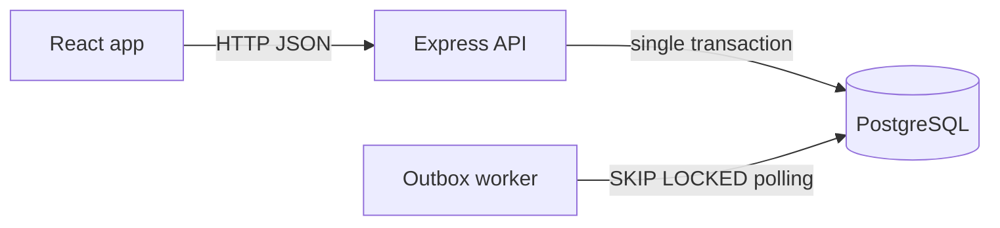
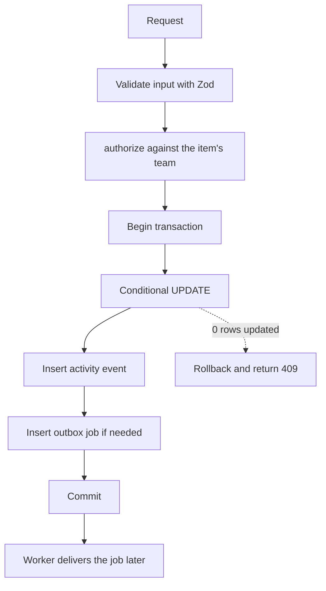
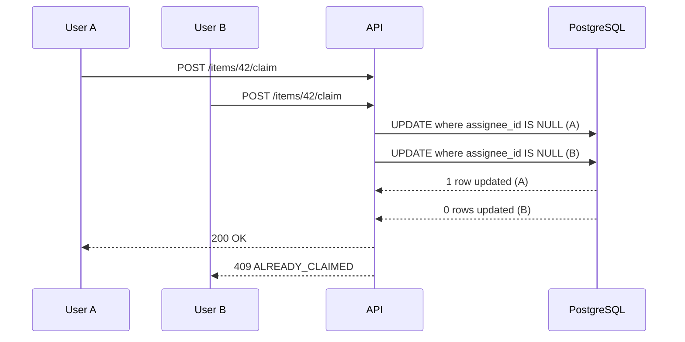

# Engineering Decisions

This document records the main engineering decisions behind **Operations Under Pressure**: what was decided, why, what it costs, and where to find it in the code. It also lists the assumptions made where the brief was open, how failures are handled, and the known limitations.

The guiding principle is that the system must stay correct when things go wrong: concurrent users, retried requests, forbidden actions and crashed workers. Features are secondary to that.

## Contents

- [Assumptions](#assumptions)
- [Architecture at a glance](#architecture-at-a-glance)
- [Decision 1: One transaction for change, history and job](#decision-1-one-transaction-for-change-history-and-job)
- [Decision 2: Conditional updates and optimistic locking](#decision-2-conditional-updates-and-optimistic-locking)
- [Decision 3: Idempotency keys stored in PostgreSQL](#decision-3-idempotency-keys-stored-in-postgresql)
- [Decision 4: Transactional outbox with a Postgres worker](#decision-4-transactional-outbox-with-a-postgres-worker)
- [Decision 5: Server-side authorization with one function](#decision-5-server-side-authorization-with-one-function)
- [Decision 6: SQL-first migrations, Prisma as query client](#decision-6-sql-first-migrations-prisma-as-query-client)
- [Decision 7: Keyset pagination and database full-text search](#decision-7-keyset-pagination-and-database-full-text-search)
- [Failure modes](#failure-modes)
- [Testing strategy](#testing-strategy)
- [Known limitations](#known-limitations)
- [What we would do next](#what-we-would-do-next)

## Assumptions

The brief left several questions open. These are the answers we chose and built to.

| Open question | Assumption |
|---|---|
| Which statuses exist? | Open, In Progress, Awaiting Approval, Resolved, Closed |
| Who can approve? | Only a Lead (or Admin) of the item's team. Approval moves Awaiting Approval to Resolved |
| What happens on rejection? | A Lead moves the item from Awaiting Approval back to In Progress |
| Can a closed item be reopened? | No. Closed is terminal |
| What happens when two people edit at once? | The second write is rejected with 409 and the latest item. There is no automatic merge. The UI asks the user to reload |
| What happens when two people claim at once? | Exactly one wins. The other gets 409 |
| Who can be an assignee? | Any member of the item's team (not a Viewer). Anyone else is rejected with 422 |
| Can an item change team? | No. The team is fixed at creation |
| What does a user outside the team see? | 404, as if the item did not exist |
| What is a notification? | A row in the database. Email delivery is out of scope |
| Do approved tasks stay visible? | Yes. Approved items are shown in the app, and the approval is recorded in the activity timeline |

## Architecture at a glance

The write path for every item change:

Two users claiming the same item:

## Decision 1: One transaction for change, history and job

**Context.** Every state, owner and priority change must be logged, and some changes must trigger background work. If the item update, the history row and the job are written in separate steps, a crash between them leaves the system inconsistent: history that disagrees with the item, or a change with no notification.

**Decision.** Every write goes through one `inTransaction` helper. Inside it the service applies the change, calls `recordEvent` to insert the activity event, and calls the enqueue helper to insert any outbox job. Only the transaction client (`tx`) is used inside the callback, and it is passed to every helper. The activity table is also protected by a database trigger that rejects updates and deletes, so it is append-only.

**Why.** The database gives us atomicity for free. Either all three rows exist or none do, so history can never disagree with the item.

**Trade-offs.**
- Writes are slightly slower because each one inserts at least two rows.
- Service code must be disciplined. Using the global Prisma client inside a transaction silently breaks atomicity, so the rule is written down and covered by a test that forces a failure after the update and checks that nothing was saved.

**Where.** `api/src/db/transaction.ts`, `api/src/items/activity.service.ts`, `api/tests/atomic-change.test.ts`.

## Decision 2: Conditional updates and optimistic locking

**Context.** Two concurrency problems exist: two users claiming the same unassigned item, and two users editing the same item from stale copies.

**Decision.**
- **Claim** is one SQL statement: `UPDATE work_items SET assignee_id = ... WHERE id = ... AND assignee_id IS NULL AND status = 'open'`. Zero rows updated means the claim lost and the API returns `409 ALREADY_CLAIMED`.
- **Edits and transitions** use optimistic locking. The client sends the `version` it saw. The update includes `AND version = ?` and increments the version. Zero rows updated means the item changed, and the API returns `409 VERSION_CONFLICT` with the latest item so the UI can recover.
- Transitions also include the current status in the `WHERE` clause, so two Leads approving at the same moment cannot both succeed.

**Why.** The check and the write happen in a single statement, so there is no gap for another request to slip into. A read-then-write approach would pass its check in both requests and then overwrite.

**Trade-offs.**
- Clients must handle 409. The UI shows a "this item changed, reload" message and rolls back optimistic updates.
- We chose optimistic locking over pessimistic row locks (`SELECT ... FOR UPDATE`). Row locks would hold database connections while a user thinks, and they do not help across separate HTTP requests anyway.
- Under heavy contention on one item, many requests will lose and must retry. That is acceptable for this workload.

**Where.** `api/src/items/items.service.ts`, `api/src/items/transitions.ts`, `api/tests/claim.test.ts`, `api/tests/optimistic-locking.test.ts`, `api/tests/workflow.test.ts`.

## Decision 3: Idempotency keys stored in PostgreSQL

**Context.** Double-clicks, flaky networks and client retries cause the same create request to arrive more than once. Without protection, each copy creates a new item.

**Decision.** `POST /items` requires an `Idempotency-Key` header. A table keyed by `(user_id, key)` stores a hash of the request and, once finished, the response. In one transaction at the default READ COMMITTED isolation:
1. Insert the key row first with `ON CONFLICT DO NOTHING`.
2. If the insert succeeded, this request owns the key. Create the item, event and job, store the response on the key row, and commit.
3. If not, another request owns it. Postgres makes the second insert wait until the first transaction finishes, so we then read the row. A different request hash returns `422 IDEMPOTENCY_KEY_REUSED`. A stored response is replayed with the same status and body.
4. If anything fails, the key row rolls back with the transaction, so the client can safely retry with the same key.

**Why.** Putting the key in the same transaction as the work makes it all-or-nothing, and the primary key makes two simultaneous requests safe without any application-level locking. The frontend generates the key once per form and reuses it for retries.

**Trade-offs.**
- The table grows without bound unless old keys are cleaned up (see limitations).
- Idempotency is required on item creation only. Other writes are protected by optimistic locking and conditional updates, which make repeats harmless in a different way.
- Hashing the request body adds a small cost per request.

**Where.** `api/src/idempotency/idempotency.ts`, `api/tests/idempotency.test.ts`.

## Decision 4: Transactional outbox with a Postgres worker

**Context.** Assigning an item should notify the new assignee. Calling a notification service inside the request is unreliable: it can fail after the change commits, or succeed and then have the change roll back.

**Decision.** The job is written to an `outbox_jobs` table in the same transaction as the change (Decision 1). A separate worker process polls for ready jobs and claims them with `FOR UPDATE SKIP LOCKED`, so several workers never take the same job. The handler runs in a transaction together with the update that marks the job done. On failure the job goes back to pending with exponential backoff, capped at five minutes, until `max_attempts` is reached, then it is marked `failed` with the last error. A reaper returns jobs stuck in `processing` to the queue.

**Why.** Delivery is at-least-once, so duplicates are possible. We make the handler idempotent instead of trying to prevent duplicates: notifications have a unique `dedupe_key` and the handler inserts with `ON CONFLICT DO NOTHING`. Processing a job twice therefore creates one notification.

**Trade-offs.**
- We chose a Postgres table over Redis and BullMQ. There is one fewer service to run and the job commits with the change. The cost is polling latency of a second or two and extra load on the database.
- Failed jobs need a human or a script to inspect them. There is no dead-letter dashboard.
- Notifications are database rows rather than emails, which keeps the focus on reliability.

**Where.** `api/src/outbox/enqueue.ts`, `api/src/outbox/worker.ts`, `api/src/outbox/handlers.ts`, `api/tests/outbox.test.ts`.

## Decision 5: Server-side authorization with one function

**Context.** Permissions checked only in the frontend can be bypassed with any HTTP client. Permission checks scattered across handlers get forgotten.

**Decision.** One `authorize(user, teamId, minRole)` function is called by every service before it does any work. Memberships are loaded from the database on every request, so a role change applies immediately. Lists, search and dashboards always filter by the user's team ids, and a client-supplied team filter is intersected with them, never trusted. The workflow adds a second check: the transition map says which role may take each step, and only Leads may approve.

**Why.** A single choke point is easy to review and test. Scoping the queries themselves, not just the single-item routes, closes the common leak where a list endpoint returns other teams' data.

**Trade-offs.**
- A user outside an item's team gets **404**, not 403, so the API does not reveal that the item exists. This makes debugging permission problems slightly harder.
- Loading memberships on each request adds one query. It is cheap and keeps roles current.
- There is no row-level security in the database. The application is the only enforcement layer.

**Where.** `api/src/auth/authorize.ts`, `api/src/items/transitions.ts`, `api/tests/authorization.test.ts`, `api/tests/workflow.test.ts`.

## Decision 6: SQL-first migrations, Prisma as query client

**Context.** The design needs a generated `tsvector` column, a GIN index and several partial indexes. Prisma cannot model these and would try to drop them if it managed the schema.

**Decision.** Hand-written SQL migrations are the source of truth and are applied with `prisma migrate deploy`. The Prisma schema is produced with `prisma db pull`. Prisma is used as a typed query client for simple reads and writes. Statements where the exact SQL matters (conditional updates, idempotency inserts, outbox claiming, search and list queries) use tagged-template raw SQL, which binds parameters safely. `prisma migrate dev` and `prisma db push` are not used.

**Why.** The database objects that make the system fast and correct are written exactly as intended, and the race-sensitive statements are visible in the code rather than hidden behind an ORM method.

**Trade-offs.**
- Two representations of the schema exist: the SQL and the generated Prisma schema. They are kept consistent by always regenerating from the database.
- Generated model names are snake_case, which is less idiomatic in TypeScript.
- Raw SQL gives up some compile-time checking, so those paths are covered by tests.

**Where.** `api/prisma/migrations/`, `api/prisma/schema.prisma`.

## Decision 7: Keyset pagination and database full-text search

**Context.** The seed creates thousands of items, and the brief forbids loading everything into the browser.

**Decision.** Lists use keyset pagination ordered by `(created_at DESC, id DESC)` with an opaque cursor, a default page of 25 and a maximum of 100. The cursor timestamp is taken from `created_at::text` in SQL, not from a JavaScript `Date`, because JavaScript keeps milliseconds while PostgreSQL keeps microseconds, and rounding would skip or repeat rows. Search uses a generated `tsvector` column with a GIN index and `websearch_to_tsquery`. Partial indexes back the three dashboard views.

**Why.** Offset pagination slows down on deep pages and shifts when rows are inserted. Keyset pagination stays fast and stable. Search and filtering run in the database where the indexes are.

**Trade-offs.**
- Users cannot jump straight to page N.
- Sorting is fixed to newest first. Other orderings would need new indexes and cursor logic.
- Search uses the English configuration, so it handles stemming for English only.

**Where.** `api/src/items/items.queries.ts`, `api/src/lib/cursor.ts`, `api/tests/pagination.test.ts`.

## Failure modes

| Scenario | What happens |
|---|---|
| Database error in the middle of a change | The transaction rolls back. The item, event and job are all unchanged |
| Two users claim or approve at once | One succeeds, the other gets 409. State changes exactly once |
| Stale edit | 409 with the latest item. Data is unchanged. The UI offers a reload |
| Client retries a create after a timeout | The same idempotency key returns the stored response. No duplicate item |
| Two identical create requests arrive together | The second waits on the key row, then replays the first result |
| Server crashes after commit but before responding | The client retries with the same key and receives the stored response |
| Worker crashes while processing a job | The reaper returns the job to pending after five minutes |
| Handler fails | The job retries with exponential backoff, then is marked failed with its last error |
| A job is delivered twice | The unique `dedupe_key` makes the second delivery a no-op |
| Database unreachable at startup | The service retries for up to 30 seconds, then exits with a clear error |
| Unexpected exception in a request | A generic 500 with a request id. Stack traces and SQL stay in the server logs |

## Testing strategy

- Tests run against a real PostgreSQL database (`ops_test`). Concurrency, locking and `SKIP LOCKED` behave differently in mocks, so nothing is mocked.
- The connection pool is large enough for requests to run truly in parallel. Concurrency tests use `Promise.all` over real HTTP requests.
- Tables are reset before each test, and test files run one after another so they do not share state.
- Tests assert database state, not only HTTP responses: item version, event rows, notification counts and job status.
- One test file covers each critical behaviour: atomic change, claim, optimistic locking, idempotency, workflow, authorization, outbox, pagination and the error contract.

## Known limitations

**Out of scope by design (as allowed by the brief)**
- No email delivery. Notifications are stored in the database.
- No file attachments, SSO or sign-up flow. Users are seeded.
- No real-time updates. The UI refetches instead of using websockets.
- Minimal styling.

**Engineering limitations**
- Idempotency keys and finished outbox jobs are never deleted. A production system needs a retention job.
- Idempotency is required on item creation only.
- A Lead who is assigned to an item can approve their own work. There is no separation-of-duties rule.
- Authentication uses bearer tokens with no refresh or revocation. A token is valid until it expires, although role changes apply immediately.
- No rate limiting or account lockout on login.
- All seeded users share one demo password, which is acceptable only for local use.
- Full-text search is English-only.
- Pagination is newest-first only.
- Failed outbox jobs have no admin screen. They must be inspected in the database.
- There is no database-level row security. Authorization lives in the application.
- Basic logging only. There are no metrics or tracing.

## What we would do next

1. Add a retention job that expires old idempotency keys and finished jobs.
2. Require an idempotency key on every state-changing endpoint.
3. Add a rule that prevents approving one's own work, or make it configurable per team.
4. Reduce worker latency with `LISTEN/NOTIFY`, keeping polling as the fallback.
5. Add rate limiting, refresh tokens and token revocation.
6. Add an admin view for failed jobs with a retry button.
7. Add PostgreSQL row-level security as a second line of defence behind the application checks.
8. Add metrics for queue depth, failed jobs, conflict rates and request latency.