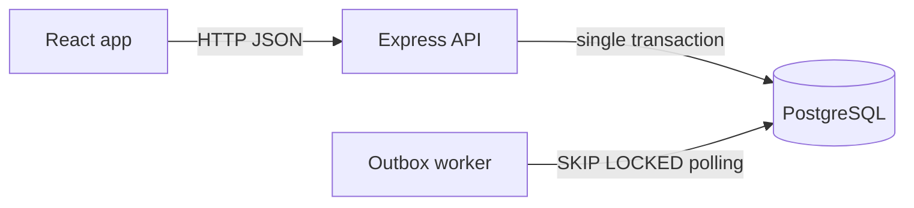
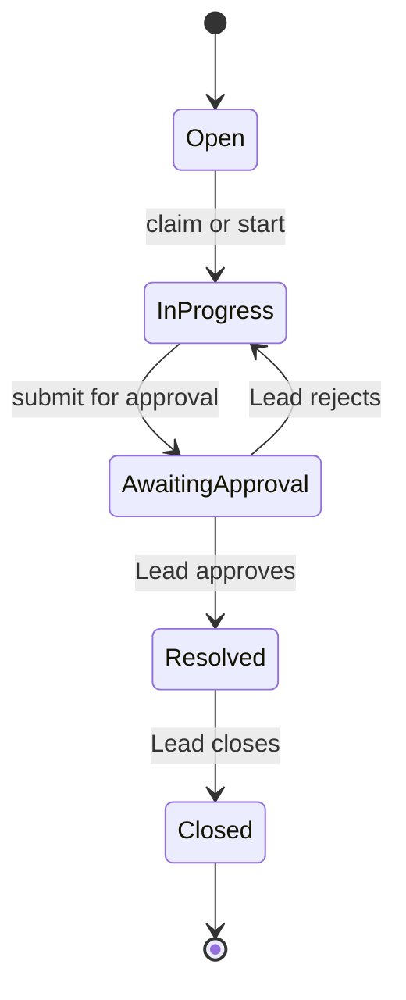

# Operations Under Pressure

An internal web app for creating, assigning, tracking and resolving operational work items across teams. Built for the Newtonite Software Engineering Challenge (full-stack track).

The focus is correctness under pressure, not screens. Two people claiming the same item, a double-clicked submit, a stale edit, a forbidden action, a background job that fails halfway: the system handles each of these on the server and proves it with automated tests.

## Table of contents

- [Features](#features)
- [Tech stack](#tech-stack)
- [Architecture](#architecture)
- [Quick start](#quick-start)
- [Seeded users](#seeded-users)
- [Workflow and permissions](#workflow-and-permissions)
- [Critical behaviours](#critical-behaviours)
- [API overview](#api-overview)
- [Running the tests](#running-the-tests)
- [Project structure](#project-structure)
- [Scripts](#scripts)
- [Design decisions](#design-decisions)
- [Known limitations](#known-limitations)
- [Troubleshooting](#troubleshooting)
- [Commit convention](#commit-convention)

## Features

**Core**

- Seeded users and teams, token login, and a role per team (Viewer, Member, Lead, Admin)
- Work items with title, description, type (incident, customer issue, payment, compliance, task), priority, status, team, assignee, creator, due date, version and timestamps
- Server-enforced workflow: Open, In Progress, Awaiting Approval, Resolved, Closed, with an approval step that only a Lead can pass
- Append-only activity log for every status, owner and priority change, plus comments
- Dashboard with three views: **Assigned to me**, **Unassigned urgent** and **Awaiting my approval**
- Search, filters and cursor-based pagination, all done on the server
- Transactional outbox with a background worker that notifies new assignees, with retries and a maximum attempt limit
- Clear error handling in the UI, including a "this item changed, reload" message on version conflicts and rollback of optimistic updates when the server rejects them

**Extra feature**

- **Approved tasks are shown.** When a Lead approves a task, it is surfaced as approved in the app so the team can see what has been signed off, and the approval is recorded in the item's activity timeline.

## Tech stack

| Layer | Technology |
|---|---|
| Backend | Node.js, TypeScript, Express |
| Validation | Zod |
| Database | PostgreSQL 16 |
| Data access | Prisma client, with raw SQL for the concurrency-critical statements |
| Auth | JWT, argon2 or bcrypt password hashing |
| Background jobs | Postgres outbox table and a worker using `FOR UPDATE SKIP LOCKED` |
| Frontend | React, Vite, TanStack Query v5, React Router |
| Tests | Vitest and Supertest against a real PostgreSQL database |
| Infrastructure | Docker Compose (db, migrate, api, worker, web) |

## Architecture



Every change to a work item runs in one database transaction that applies the change, writes the activity event, and enqueues any outbox job. History can therefore never disagree with the item, and a job exists if and only if the change committed.

The API server and the worker share one codebase and one Docker image. Only the start command differs.

## Quick start

### Prerequisites

- Git
- Docker with Docker Compose v2 (`docker compose version` should work)
- Free local ports for the web app, the API and PostgreSQL (see `docker-compose.yml`)

Node.js 20 or newer is only needed if you want to run the code outside Docker.

### Run it

```bash
git clone <your-repo-url>
cd <your-repo-folder>
cp .env.example .env
docker compose up --build
```

On first start Docker Compose will:

1. start PostgreSQL and wait until it is healthy
2. run the migrations and the seed (the seed is safe to run again)
3. start the API, the worker and the web app

Then open:

| Service | URL |
|---|---|
| Web app | http://localhost:5173 |
| API | http://localhost:3000 |

Log in with any seeded user below.

To stop everything, press `Ctrl+C`. To wipe the database and start clean:

```bash
docker compose down -v
docker compose up --build
```

## Seeded users

There is no sign-up flow. All seeded users share the same password:

**Password for every user: `password123`**

| Name | Email | Role |
|---|---|---|
| Alice Admin | alice@example.com | Admin |
| Bob Lead | bob@example.com | Lead |
| Charlie Member | charlie@example.com | Member |
| Diana Viewer | diana@example.com | Viewer |
| Eve Lead | eve@example.com | Lead |
| Frank Member | frank@example.com | Member |
| Grace Admin | grace@example.com | Admin |
| Hank Member | hank@example.com | Member |
| Ivy Lead | ivy@example.com | Lead |
| Jack Viewer | jack@example.com | Viewer |

Roles are assigned per team, and the exact team memberships are defined in `api/prisma/seed.ts`. The seed also creates several teams and thousands of sample work items so that pagination, filtering and search can be tried on realistic volumes.

Good logins to try:

- **Diana (Viewer)** to confirm that read-only users cannot change anything
- **Charlie (Member)** to create, claim and submit work for approval
- **Bob (Lead)** to approve or reject items that are awaiting approval

These accounts are for local demonstration only. Do not reuse this seed or password in any real environment.

## Workflow and permissions



Any transition not shown above (for example Open to Closed) is rejected by the server with `409 INVALID_TRANSITION` and changes nothing.

| Action | Viewer | Member | Lead | Admin |
|---|---|---|---|---|
| Read items, comments and activity | Yes | Yes | Yes | Yes |
| Create item, comment, claim | No | Yes | Yes | Yes |
| Edit an item | No | Own or assigned items | Any item | Any item |
| Submit for approval | No | If assigned | Yes | Yes |
| Approve, reject, reassign, close | No | No | Yes | Yes |
| Manage team membership | No | No | No | Yes |

Authorization is enforced on the server by a single `authorize()` function that every endpoint uses, scoped to the item's team. A user outside the item's team receives `404`, and a team member whose role is too low receives `403`.

## Critical behaviours

Each behaviour below goes beyond plain CRUD and has an automated test.

| Situation | How it is handled | Test |
|---|---|---|
| Change and history must agree | Update, activity event and outbox job are written in one transaction. A failure rolls everything back | `atomic-change.test.ts` |
| Two users claim the same item | One conditional `UPDATE ... WHERE assignee_id IS NULL AND status = 'open'`. Zero rows updated returns `409 ALREADY_CLAIMED`. Exactly one claim wins | `claim.test.ts` |
| Editing a stale version | Optimistic locking with `AND version = ?` and an increment. A mismatch returns `409 VERSION_CONFLICT` with the latest item, and data is unchanged | `optimistic-locking.test.ts` |
| Repeated request (double-click, retry) | `Idempotency-Key` header. The key row is inserted first in the same transaction. A repeat returns the stored response. The same key with a different body returns `422` | `idempotency.test.ts` |
| Invalid workflow step or non-Lead approval | Server-side transition map and role check. Rejected requests leave status and version unchanged and write no event | `workflow.test.ts` |
| Access across teams or by a Viewer | One `authorize()` function. Lists, search and dashboards are scoped to the user's teams | `authorization.test.ts` |
| Reliable background work | Transactional outbox, `FOR UPDATE SKIP LOCKED`, exponential backoff, maximum attempts, a reaper for stuck jobs, and an idempotent handler. Processing a job twice creates one notification | `outbox.test.ts` |
| Large lists | Keyset pagination on `(created_at, id)` with a cursor taken from the exact database timestamp, plus full-text search with a GIN index | `pagination.test.ts` |
| Consistent errors | One error format and one error middleware. No stack traces or SQL reach the client | `error-contract.test.ts` |

### Error format

Every error response has the same shape:

```json
{ "error": { "code": "VERSION_CONFLICT", "message": "...", "details": {} } }
```

| Status | Codes |
|---|---|
| 400 | `VALIDATION_ERROR` |
| 401 | `UNAUTHENTICATED`, `INVALID_CREDENTIALS` |
| 403 | `FORBIDDEN` |
| 404 | `NOT_FOUND` |
| 409 | `ALREADY_CLAIMED`, `VERSION_CONFLICT`, `INVALID_TRANSITION`, `IDEMPOTENCY_IN_PROGRESS` |
| 422 | `IDEMPOTENCY_KEY_REUSED`, `ASSIGNEE_NOT_IN_TEAM` |
| 500 | `INTERNAL` |

## API overview

| Method and path | Purpose |
|---|---|
| `POST /auth/login` | Log in and receive a token |
| `GET /items` | List items. Query: `status`, `priority`, `assignee`, `q`, `cursor`, `limit` |
| `POST /items` | Create an item. Requires an `Idempotency-Key` header |
| `GET /items/:id` | Item detail |
| `PATCH /items/:id` | Edit an item. Body must include the current `version` |
| `POST /items/:id/claim` | Atomically claim an unassigned open item |
| `POST /items/:id/transition` | Move through the workflow. Body includes `to` and `version` |
| `GET /items/:id/activity` | Activity timeline |
| `POST /items/:id/comments` | Add a comment |
| `GET /dashboard` | Assigned to me, Unassigned urgent, Awaiting my approval |

All endpoints except login require `Authorization: Bearer <token>`.

## Running the tests

The tests run against a real PostgreSQL database named `ops_test`, created by `db/init-test-db.sql`. Concurrency tests need real parallel connections, so nothing is mocked.

With the stack running:

```bash
docker compose exec api npm test
```

Or locally, with the database container up:

```bash
docker compose up -d db
cd api
npm install
npm test
```

Check `.env.example` for the test database settings. The tests reset their own tables between runs and never touch the development data.

## Project structure

```text
.
├── docker-compose.yml
├── .env.example
├── README.md
├── ENGINEERING_DECISIONS.md
├── db/
│   └── init-test-db.sql            # creates the ops_test database
├── api/
│   ├── Dockerfile                  # one image for api, worker and migrate
│   ├── prisma/
│   │   ├── migrations/             # SQL-first migrations
│   │   ├── schema.prisma           # produced by prisma db pull
│   │   └── seed.ts                 # idempotent seed
│   ├── src/
│   │   ├── app.ts                  # Express app (exported, no listen)
│   │   ├── server.ts               # API entry point
│   │   ├── worker.ts               # worker entry point
│   │   ├── config/                 # validated environment
│   │   ├── db/                     # Prisma client, transaction helper
│   │   ├── errors/                 # AppError and error middleware
│   │   ├── auth/                   # login, token middleware, authorize()
│   │   ├── items/                  # routes, schemas, services, queries, transitions
│   │   ├── dashboard/              # dashboard views
│   │   ├── idempotency/            # idempotency keys
│   │   ├── outbox/                 # enqueue, worker, handlers
│   │   └── lib/                    # logger, cursor
│   └── tests/                      # one file per critical behaviour
└── web/
    └── src/
        ├── api/                    # apiFetch, ApiError, query hooks
        ├── auth/                   # login state, protected routes
        ├── pages/                  # login, dashboard, items, item detail
        └── components/             # error banner, tables, timeline, actions
```

Layering rules: routes only validate input and call one service. Services own the transactions and call `authorize()` before changing anything. Raw SQL for reads lives in `*.queries.ts` files. The web app talks to the API only over HTTP.

## Scripts

Run these from the `api/` folder.

| Script | What it does |
|---|---|
| `npm run dev` | Run the API with reload |
| `npm run build` | Compile TypeScript to `dist` |
| `npm run start` | Start the API |
| `npm run start:worker` | Start the outbox worker |
| `npm run migrate:deploy` | Apply the SQL migrations |
| `npm run db:pull` | Regenerate the Prisma schema and client from the database |
| `npm run seed` | Run the seed (safe to run twice) |
| `npm test` | Run the test suite against `ops_test` |

## Design decisions

The main trade-offs are written up in [ENGINEERING_DECISIONS.md](ENGINEERING_DECISIONS.md). In short:

- **Postgres outbox instead of Redis and a queue.** The job row commits in the same transaction as the change, so there is no window where a change exists without its job. The cost is polling.
- **SQL-first migrations.** Prisma cannot model the generated search column or the partial indexes, so the SQL files are the source of truth and Prisma is used as the query client. Never run `prisma migrate dev` or `prisma db push` on this database.
- **Raw SQL for race-sensitive statements.** Claim, idempotency and job claiming are single statements, so the check and the write cannot be separated.
- **404 for users outside a team.** It avoids revealing that an item exists.
- **Keyset pagination.** Stable under inserts and fast on large tables, at the cost of not supporting jumping to page N.

## Known limitations

These were deliberately left out of scope, as the brief allows:

- No email delivery. Notifications are stored in the database.
- No file attachments.
- No SSO or sign-up flow. Users are seeded.
- No real-time updates. The UI refetches instead of using websockets.
- Seeded demo accounts share one password and are not meant for production.
- Minimal styling.

See [ENGINEERING_DECISIONS.md](ENGINEERING_DECISIONS.md) for further limitations.

## Troubleshooting

| Problem | Fix |
|---|---|
| A port is already in use | Stop the other process or change the port in `docker-compose.yml` |
| The API cannot reach the database | Wait for the db healthcheck, or run `docker compose up --build` again |
| Data looks wrong or migrations fail after changes | Reset with `docker compose down -v`, then `docker compose up --build` |
| Tests fail with connection errors | Make sure the `db` service is running and the `ops_test` database exists |
| Login fails | Use an email from the seeded users table and the password `password123` |

## Commit convention

Commits follow Conventional Commits: `feat`, `fix`, `test`, `docs` and `chore`, for example `feat(items): add atomic claim`.